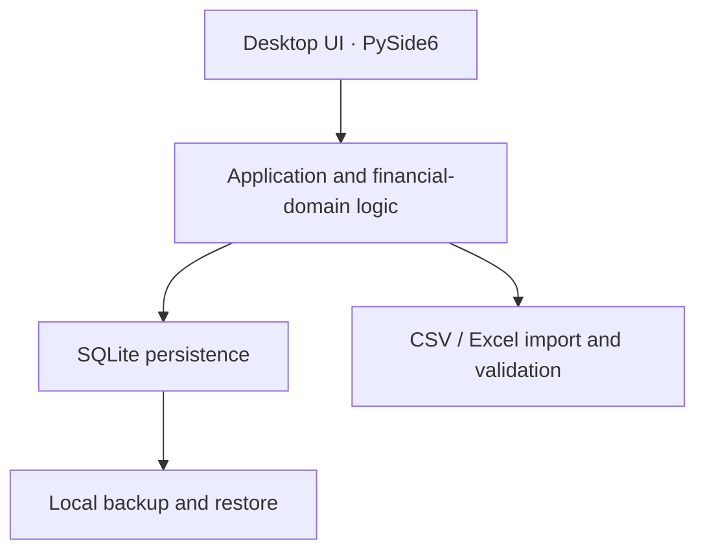

# Tallow — Software Engineering Portfolio

**Private-source, local-first personal finance desktop application**

Tallow is an independently developed Windows desktop application for budgeting, transaction management, and financial reporting. This repository is a **portfolio overview only**; the application source code and implementation-level documentation are not included.

## What the application does

- Dashboard with monthly income, expenses, savings rate, and charts
- Accounts, transactions, transfers, filtering, and search
- CSV and Excel transaction imports, duplicate detection, category mapping, and import undo
- Budgets, recurring payments, savings and debt goals, net worth, and reports
- Local data storage, checked backups, and recovery options

## Engineering stack

- **Language:** Python 3.14
- **Desktop UI:** PySide6 / Qt
- **Database:** SQLite
- **Testing:** pytest
- **Packaging:** Windows installer workflow
- **Development:** Git, documented milestones and architectural decisions, AI-assisted coding with Claude Code

## Architecture overview

The codebase separates UI, domain logic, and persistence concerns. Financial values are represented as integer cents to avoid floating-point currency errors.

## Engineering highlights

- Versioned SQLite database setup and documented data-integrity rules
- Reconciliation and duplicate detection during imports
- Automated tests across financial logic and application behaviors
- Reproducible synthetic-data performance tests at approximately 15.5k, 44.7k, and 89.2k transactions
- Explicit performance targets for interaction latency, startup, import responsiveness, and memory
- Decision logs, architecture notes, development roadmap, and dependency/license tracking

Performance targets and test workloads are documented in [Engineering Notes](docs/ENGINEERING.md). They describe the project's test setup, not independent third-party verification.

## AI-assisted development

Claude Code is used in the development workflow. The project maintains written design decisions, requirements, and validation criteria; generated changes are assessed against tests, documented behaviors, and performance targets. This describes **AI-assisted software engineering**, not an LLM-powered feature within Tallow.

## Privacy and availability

Tallow is designed to keep personal finance data on the user's computer, without requiring a cloud account or remote server. This repository is for portfolio presentation only; it does not include source code, installers, financial records, credentials, or proprietary implementation details.

**Status:** Active development; milestone 12 (Better Imports) built and reviewed in the source snapshot provided.

## Intellectual property

Tallow and its branding are associated with their respective owner. **All rights reserved.** No source-code license or permission to copy the private application is granted by this portfolio repository.
